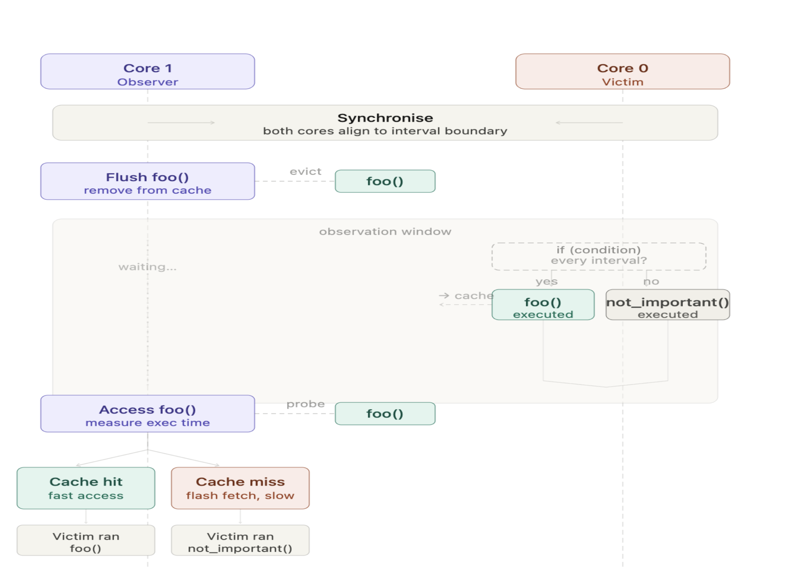
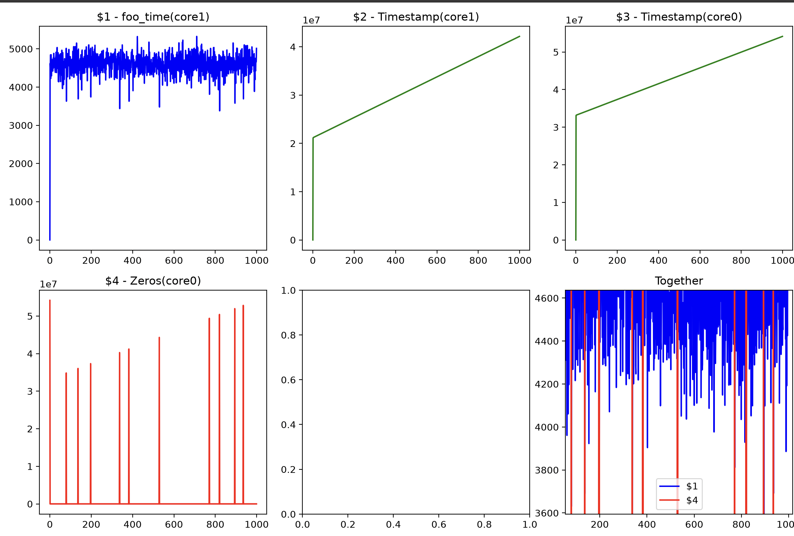

## How to Run

We need two terminals.

**Terminal 1:** Build and flash the firmware, then start the OpenOCD server:

```bash

make clean && make && make flash && make openocd-server

```

Leave `make openocd-server` running.

**Terminal 2:** Run the analysis:

```bash

make do_analysis

```

This will retrieve the recorded results and run the analysis script to generate graphs for all recorded arrays.

## Observations and Experimental Logic

### 1. Core Synchronization

There are two timestamp arrays: `timestamp_core0` and `timestamp_core1`, and two counters: `cpu0_counter` and `cpu1_counter`.

The timestamp arrays are used to examine synchronization between the two cores. The idea is to compare the timestamps recorded at corresponding indices to determine how closely the two cores' measurements align.

### 2. Recording Function Execution

Two additional arrays are used:

- `zero`: Records the timestamps at which Core 0 executes `foo()`.

- `foo_time`: Records how long Core 1 takes to execute `foo()`.

The hypothesis is that if Core 0 executes `foo()` at the time recorded in `zero[i]`, Core 1 should subsequently execute `foo()` faster because Core 0 has already accessed the function and may have brought its instructions into the cache.

### 3. Results

#### Constant Input Data


As shown in the graph, Core 1's execution time for `foo()` decreases around the points where Core 0 executes the same function. This is consistent with the hypothesis that Core 0's execution affects the subsequent execution time observed by Core 1.

#### Random Input Data

I also repeated the experiment using random input data to investigate whether the observed decreases in `foo_time` were associated with Core 0's execution of `foo()` rather than simply with the use of constant input data.



The results show a similar pattern: Core 1's execution time decreases around the points associated with Core 0's execution of `foo()`.

These observations are consistent with a possible cache-related timing effect. Further investigation is needed to distinguish this explanation from other factors that could influence execution time, including synchronization effects and shared-resource contention.