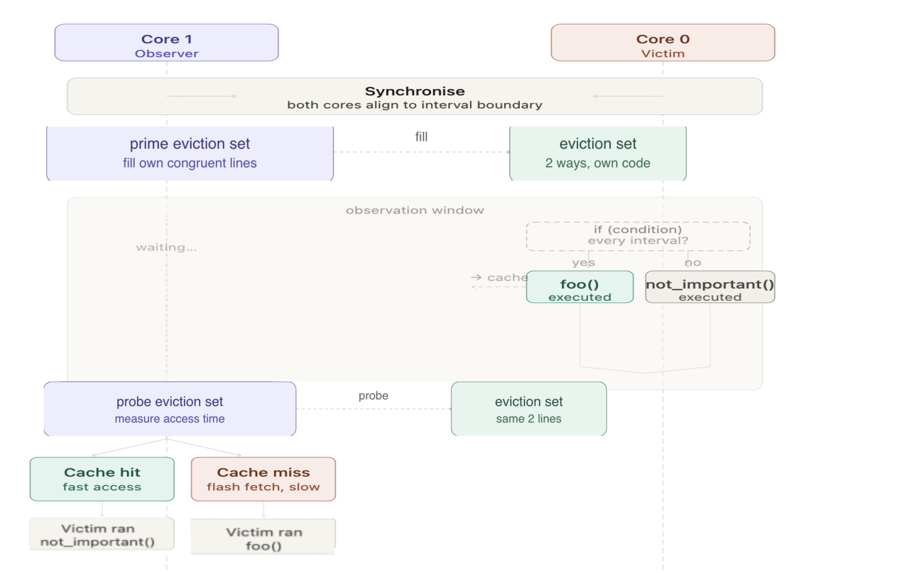
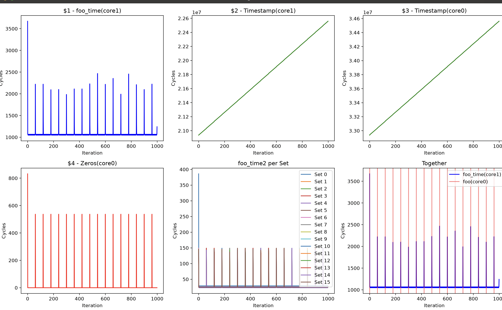
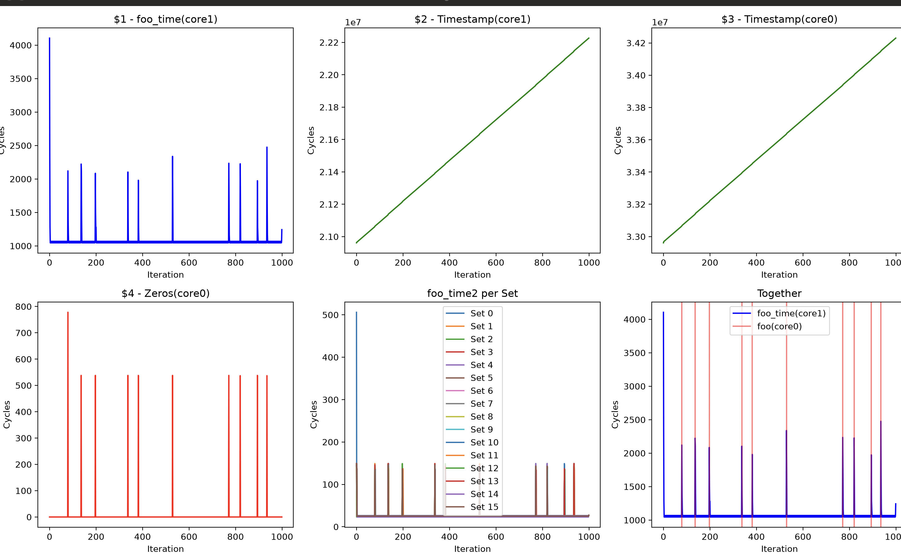

## How to Run

We need two terminals.

**Terminal 1:** Build and flash the firmware, then start the OpenOCD server:

```bash
make clean && make && make flash && make openocd-server
```

Leave `make openocd-server` running.

**Terminal 2:** Run the analysis:

```bash
make do_analysis
```

This retrieves the recorded results and runs the analysis script to generate graphs for all recorded arrays.

## Observations and Experimental Logic

### 1. Core Synchronization

There are two timestamp arrays: `timestamp_core0` and `timestamp_core1`, and two counters: `cpu0_counter` and `cpu1_counter`.

The timestamp arrays are used to examine synchronization between the two cores. The idea is to compare timestamps recorded at corresponding indices to determine how closely the two cores' measurements align.

### 2. Cache and Recording Function Execution

#### Cache Overview

One interesting difference from the Pico 1 is that, on the RP2350, specific lines can act as SRAM while others act as cache. On the Pico 1, either the whole region is cacheable or it is not.

The RP2350 instruction cache has the following properties:

- **Total cache size:** 16 KiB (16 × 1024 = 16,384 bytes)
- **Associativity:** 2-way set associative
- **Cache-hit latency:** 1 CPU cycle
- **Downstream XIP address space:** 26 bits

The cache-line size is 64 bits (8 bytes).

The total cache size is:

```text
Total cache size = number of ways × number of sets × cache-line size
```

Therefore, the number of sets is:

```text
16,384 bytes / (2 ways × 8 bytes) = 1,024 sets
```

#### Address Mapping

The physical flash size is 16 MiB (16,777,216 bytes), but the RP2350 uses a 26-bit downstream XIP address space to accommodate a larger external flash address space.

We know that:

- Number of sets: 1,024 = 2^10
- Cache-line size: 8 bytes = 2^3

Therefore, the address is divided into:

```text
Address space (26 bits) = tag + set index (10 bits) + offset (3 bits)
```

This gives the following cache-address fields:

```text
Tag (13 bits) | Set index (10 bits) | Offset (3 bits)
```

#### Mapping `foo()` to Cache Sets

The function `foo()` is located at the following addresses.

**Start address:**

```text
0x10010000 >> 3 = 0x2002000
Set index = 0x2002000 & 0x3FF = 0
```

**End address:**

```text
0x1001003A >> 3 = 0x2002007
Set index = 0x2002007 & 0x3FF = 7
```

The total size of `foo()` is 58 bytes, so its instructions occupy cache sets 0 through 7.

If we select two groups of eight addresses mapping to sets 0 through 7, they can contend for the two-way cache. For example, the following addresses all map to set 0:

```text
(0x10010000 >> 3) & 0x3FF = 0
(0x10012000 >> 3) & 0x3FF = 0
(0x10014000 >> 3) & 0x3FF = 0
```

Thus, if `foo()` at `0x10010000` executes, it may evict one of the two other lines from set 0 if both were already in the cache.

Two additional groups of spy addresses can be used to test this contention, for example:

- `0x10012000` — first spy line for set 0
- `0x10014000` — second spy line for set 0

#### Recording Function Execution

Three additional arrays are used:

- `zero`: Records the timestamps at which Core 0 executes `foo()`.
- `foo_time`: Records how long Core 1 takes to execute `probe()`.
- `foo_time2`: Records how long each eviction set takes to execute inside the `probe()` function.

The hypothesis is that if Core 0 executes `foo()` at the time recorded in `zero[i]`, Core 1 should subsequently take longer to execute `probe()` because Core 0 may have evicted cache lines used by Core 1.



### 3. Results

#### Constant Input Data



As shown in the graph, Core 1's execution time for `probe()` increases around the points where Core 0 executes `foo()`. This is consistent with the hypothesis.

#### Random Input Data

I also repeated the experiment using random input data to investigate whether the observed increase in `foo_time` was associated with Core 0's execution of `foo()`, rather than simply with the use of constant input data.



The results show a similar pattern: Core 1's execution time increases around the points associated with Core 0's execution of `foo()`.

These observations are consistent with a possible cache-related timing effect. Further investigation is needed to distinguish this explanation from other factors.
